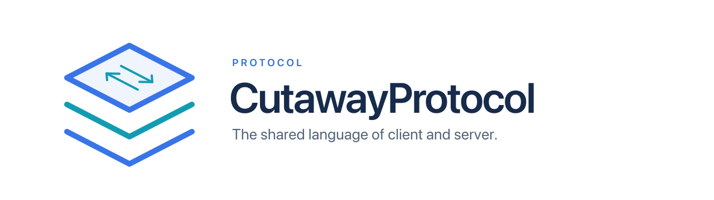

<p align="center">
  <picture>
    <source media="(prefers-color-scheme: dark)" srcset="cutaway-protocol-dark.svg">
    
  </picture>
</p>

[](../../schema/cutaway.fbs)
[](../../LICENSE)

[English](../../README.md) | [简体中文](README.zh-Hans.md) | [繁體中文](README.zh-Hant.md) | **日本語** | [한국어](README.ko.md) | [Español](README.es.md) | [Français](README.fr.md) | [Deutsch](README.de.md)

*これは翻訳です。内容が異なる場合は [英語版の README](../../README.md) が優先されます。*

# Cutaway Protocol

検査対象のアプリに組み込まれる iOS SDK である **CutawayServer** と、macOS アプリである **Cutaway** の間で使われる通信プロトコルです。Cutaway は TCP でサーバーに接続し、アプリのレイヤー階層、スクリーンショット、属性、Auto Layout の制約を取得します。また、アプリの実行中に属性を変更することもできます。

このリポジトリは、このプロトコルの唯一の信頼できる情報源です。Swift のコードは含みません。両端はこのリポジトリのタグを git submodule として固定し、スキーマからそれぞれのコードを生成します。

<a id="contents"></a>
## 内容

| パス | 説明 |
|---|---|
| `PROTOCOL.md` | 規範となる仕様です。番号付きの条項（`P-TRANS-01`、`P-FRAME-03`、…）が要件で、それ以外はすべて説明です。 |
| `schema/cutaway.fbs` | [FlatBuffers](https://flatbuffers.dev) のスキーマです。すべてのフレームのペイロードは、ここで定義される `Frame` です。 |
| `schema/released/` | リリースされた各 `MAJOR.MINOR` のスキーマのスナップショットです。リリース後は編集しません。 |
| `fixtures/` | 実装をテストするための基準フレームです。`src/` には JSON のソースが、`bin/` にはコンパイル済みのバッファと通信路上の正確なバイト列が入っています。`fixtures/README.md` を参照してください。 |
| `scripts/` | `verify.sh` はこのリポジトリの受け入れ基準です。その他のスクリプトは、フィクスチャのビルドとスキーマの進化のチェックを行います。 |
| `PROTOCOL_VERSION` | 現在のプロトコルバージョン（`MAJOR.MINOR`）です。 |
| `FLATBUFFERS_VERSION`、`FLATC_SHA256` | 固定された `flatc` のリリースと、その macOS バイナリのチェックサムです。 |

<a id="the-protocol-at-a-glance"></a>
## プロトコルの概要

- **トランスポート。** サーバーはループバックのみで TCP を待ち受け、ポート 48160 から 48167 までを順に試します。シミュレータは Mac のループバックを共有します。USB で接続したデバイスには macOS の usbmuxd を経由して到達しますが、サーバーは usbmuxd について何も関知しません。同時に接続できるクライアントは 1 つだけです。
- **フレーミング。** フレームは、4 バイトのリトルエンディアンの長さ `N` と、それに続く `N` バイトで構成されます。この `N` バイトには、ルート型が `Frame`、ファイル識別子が `CTWY` である通常の FlatBuffer が 1 つ入ります。これは FlatBuffers のサイズプレフィックス形式**ではありません**。正確なバイト列は `.stream` フィクスチャで確認できます。`N` は 256 MiB を超えてはならず、受信側はフィールドを読む前にバッファ全体を検証します。
- **ハンドシェイク。** クライアントの最初のフレームは `Hello` で、サーバーは必ず自身の `Hello` で応答します。メジャーバージョンが一致しなければ、双方が接続を閉じます。マイナーバージョンが異なる場合、双方は低い方のバージョンで動作します。
- **リクエスト。** クライアントは単調増加する `request_id` を割り当てます。通常のリクエスト（`GetAppIcon`、`GetHierarchy`、`GetSubtree`、`SetAttribute`）には、ちょうど 1 つのレスポンスが返ります。`GetLayerDetails` はストリームで、0 個以上の `LayerDetailsChunk` フレームの後に `StreamEnd` が 1 つ続きます。`Cancel` はストリームを途中で終了させ、`Cancel` 自体へのレスポンスはありません。サーバーはリクエストを順番に処理します。
- **イベント。** サーバーは、ハンドシェイクの後と、アプリのアクティブ状態が変わるたびに、`request_id` 0 の `AppStateChanged` を送信します。
- **エラー。** `Error` は安定した `ErrorCode` と、人が読めるメッセージを持ちます。クライアントは、テキストではなく必ずコードで分岐します。

上記のルールはすべて `PROTOCOL.md` の条項です。この一覧は全体像をつかむためのものにすぎません。

<a id="versioning-and-evolution"></a>
## バージョニングと進化

プロトコルバージョンは `PROTOCOL_VERSION` にある `MAJOR.MINOR` で、リリースには `vMAJOR.MINOR.PATCH` のタグが付きます。スキーマは追加のみで進化します。テーブルの末尾へのフィールドの追加と、enum および union の末尾へのメンバーの追加です。struct、ファイル識別子、ルート型は決して変わりません。それ以外の変更はすべてメジャーバージョンの引き上げとなります。`PATCH` リリースは、スキーマに触れずに文言やフィクスチャを変更します。完全なルールは `PROTOCOL.md` の `P-EVO` 条項にあります。

プロトコルは現在 **0.x で、まだ凍結されていません**。1.0 として凍結する際はメジャーバージョンの引き上げとなります。0.x のピアと 1.x のピアは、設計上ハンドシェイクに失敗します。

<a id="implementing-a-peer"></a>
## ピアの実装

1. `PROTOCOL.md` を最初から最後まで読んでください。各条項は短く、相互に参照されています。
2. 固定された `flatc`（`FLATBUFFERS_VERSION` を参照）で `schema/cutaway.fbs` からコードを生成します。`scripts/get-flatc.sh` は、そのリリースを正確に `.tools/` にダウンロードします。
3. `fixtures/bin/` に対してテストします。各 `.bin` はデコードをテストするための 1 つのバッファで、各 `.stream` はフレーミングをテストするための、シナリオ全体の一方向分です。`flatc` はデフォルト値と等しいフィールドを省略するため、デコーダはそれらを 0、false、または enum の最初のメンバーとして読み取ることに注意してください。
4. ランタイムに FlatBuffers ベリファイアのテーブル数の上限がある場合は、引き上げてください。このプロトコルでは、多くのデフォルト値をはるかに超える数のテーブルを含むフレームが許容されます（`P-FRAME-06`）。

<a id="verifying-this-repository"></a>
## このリポジトリの検証

```bash
scripts/verify.sh
```

このスクリプトは、固定された `flatc` をダウンロードし、スキーマをコンパイルし、すべてのフィクスチャを再ビルドして結果を `fixtures/bin/` と比較します。さらに、スキーマでは表現できない条項に照らしてフィクスチャをチェックし、現在のスキーマが最新のリリース済みスナップショットからの許容された進化であることを確認します。`bash`、`curl`、`python3` が必要で、macOS でのみ動作します。フィクスチャのチェックでは `compression_tool` で画像を展開し、`get-flatc.sh` は macOS 版の `flatc` をダウンロードするためです。

`fixtures/src/` またはスキーマを編集した後は、次を実行します。

```bash
scripts/build-fixtures.sh fixtures/bin
```

<a id="license"></a>
## ライセンス

MIT です。`LICENSE` を参照してください。
